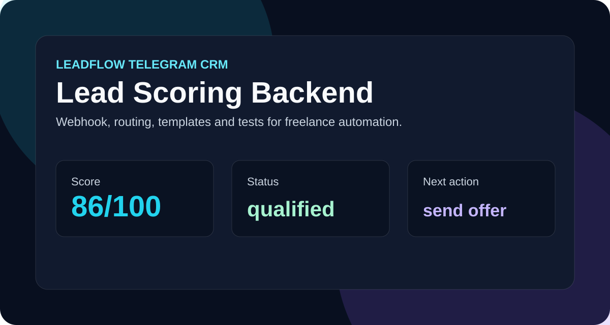

# LeadFlow Telegram CRM



Zero-dependency Node.js service for freelancers who receive leads from Telegram or Kwork and want to qualify them automatically.

## What it shows

- Backend architecture without external packages.
- Lead scoring and pipeline logic.
- Telegram-style webhook endpoint.
- Message templates for first replies and follow-ups.
- Tests using the built-in Node test runner.

## Run

```bash
npm run check
npm test
npm run demo
npm start
```

Server starts at `http://localhost:8080`.

## API

```bash
curl -X POST http://localhost:8080/webhook/telegram \
  -H "Content-Type: application/json" \
  -d '{"user":"client","text":"Нужно сделать сайт за неделю, бюджет 25000"}'
```

Useful endpoints:

- `GET /health`
- `GET /leads`
- `POST /webhook/telegram`

## Why this is portfolio-friendly

The project is small enough to understand quickly, but it demonstrates practical backend thinking: scoring, routing, templates, state management, JSON API and tests.
